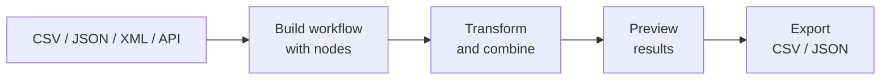
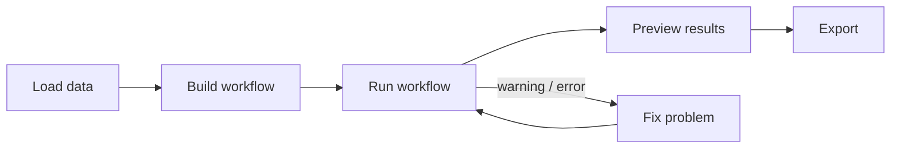
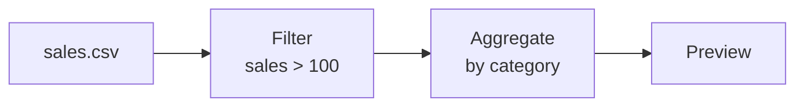

<!-- @slide Title -->

<!-- 5xl -->
# Visual ETL Application

*A visual, local-first way to build repeatable data workflows without programming.*

<!-- @set-align left -->
<!-- @set-width 65% -->

**Author:** Hugo Alberto Lugo Esperilla

**Neptun:** ADFUXK

**Supervisor:** Gergely Laborci

**Project ID:** 2026-LG-02

---

<!-- @slide Problem -->

## Problem

<!-- @set-align left -->
<!-- @set-width 70% -->

- Spreadsheet users often repeat the same **cleaning and transformation steps manually**.
- Scripts and professional ETL tools can solve this, but they usually require **programming knowledge** or technical terminology.
- When a workflow breaks, the user should understand **what is wrong and how to fix it**.

<!-- @callout question -->
> Can a non-programmer build, run, inspect, and repair a data workflow visually?

<!-- @note -->
> The goal is not to replace mature ETL tools. The project focuses on a smaller, understandable end-to-end workflow system for spreadsheet-familiar users.

---

<!-- @slide Project idea -->

### From raw data to a usable result

The user connects visible processing steps instead of writing a script.

<!-- @note -->
> Every node can expose its result for preview and pass that result to a compatible downstream node.

---

<!-- @slide Target users -->

## Target users

<!-- @set-align left -->
<!-- @set-width 70% -->

**People who understand basic tabular data, but are not expected to know programming or ETL terminology.**

The user wants to:

- load local data or a simple API source
- build a repeatable workflow visually
- preview intermediate results
- understand warnings and errors in plain language
- export the final result

**Advanced option:** a Custom Code node can be used by technical users, but normal workflows do not depend on it.

---

<!-- @slide Planned scope -->

## Planned scope

<!-- @set-align left -->
<!-- @columns 2 4 -->

### In scope

- CSV, JSON, XML, API GET
- Filter
- Select / Rename Fields
- Aggregate
- Combine Tables
- Preview intermediate results
- Run / Cancel
- Warnings and errors
- CSV / JSON export
- Advanced Custom Code node

<!-- @col-break -->

### Out of scope

- Workflow sharing
- Versioning
- Reusable templates
- Advanced authentication
- Full general-purpose API client
- Automatic silent type conversion
- Large enterprise ETL feature set

<!-- @columns -->

<!-- @note -->
> The MVP is intentionally end-to-end rather than feature-heavy: source → transformation → execution → preview → export.

---

<!-- @slide Workflow rules -->

### How the workflow behaves

<!-- @set-align left -->
<!-- @set-width 70% -->

- The workflow cannot contain **loops**.
- Nodes run only when their required upstream inputs are ready.
- Incompatible connections remain visible and explain **why they are invalid**.
- A **warning** means a meaningful result still exists; an **error** means it does not.
- Local file contents stay on the user's device during processing.

<!-- @note -->
> Dates are treated as Text in the first version and ambiguous inferred values also default to Text. This keeps automatic behavior conservative and predictable.

---

<!-- @slide User journeys -->

## Initial user journeys

Three main journeys cover the required end-to-end experience.

---

<!-- @slide Journey 1 -->

### Build and run a workflow

<!-- @set-align left -->
<!-- @set-width 70% -->

1. Add a CSV, JSON, XML, or API source.
2. Drag transformation nodes onto the canvas.
3. Connect compatible outputs and inputs.
4. Configure each selected node in the side panel.
5. Select **Run workflow**.
6. The system validates the graph and executes nodes in dependency order.

<!-- @note -->
> Multi-input nodes, such as Combine Tables, wait until all required inputs are available. Cycles are rejected before execution.

---

<!-- @slide Journey 2 -->

### Transform, combine, and inspect data

<!-- @set-align left -->
<!-- @set-width 70% -->

- Preview source or intermediate results without interrupting the workflow.
- Use Filter, Select/Rename, Aggregate, and Combine Tables as reusable steps.
- Large previews show only a bounded sample rather than the entire dataset.

<!-- @note -->
> Combine Tables uses two table-like inputs and supports matching-only or keep-all-first-table behavior. Grouped aggregation returns a table; ungrouped aggregation returns a single value.

---

<!-- @slide Journey 3 -->

### Understand problems and export

<!-- @set-align left -->
<!-- @set-width 70% -->

1. A node or connection is marked as warning, error, or invalid.
2. The user selects it and sees a **plain-language explanation**.
3. The user changes the source, configuration, or connection.
4. The workflow is revalidated and run again.
5. A successful result is exported as **CSV or JSON**.

<!-- @callout info -->
> Example: “Filter needs table data, but Aggregate currently produces a single value.”

<!-- @note -->
> CSV export is limited to table-like data. JSON can represent every supported transferable data shape.

---

<!-- @slide Next steps -->

## Next steps

<!-- @set-align left -->
<!-- @set-width 70% -->

- Prototype the visual graph editor: draggable nodes, connections, validation, and cycle prevention.
- Implement source loading, schema inference, and the core transformation nodes.
- Complete the **Run → Preview → Export** path with cancellation and execution states.
- Test representative workflows with at least **50,000 rows**.
- Prototype the highest-risk areas early: large joins, Custom Code sandboxing, and desktop packaging.

<!-- @note -->
> A practical usability success criterion is that a first-time spreadsheet-familiar user can load a CSV, add a Filter, preview the result, and export it without external documentation.
